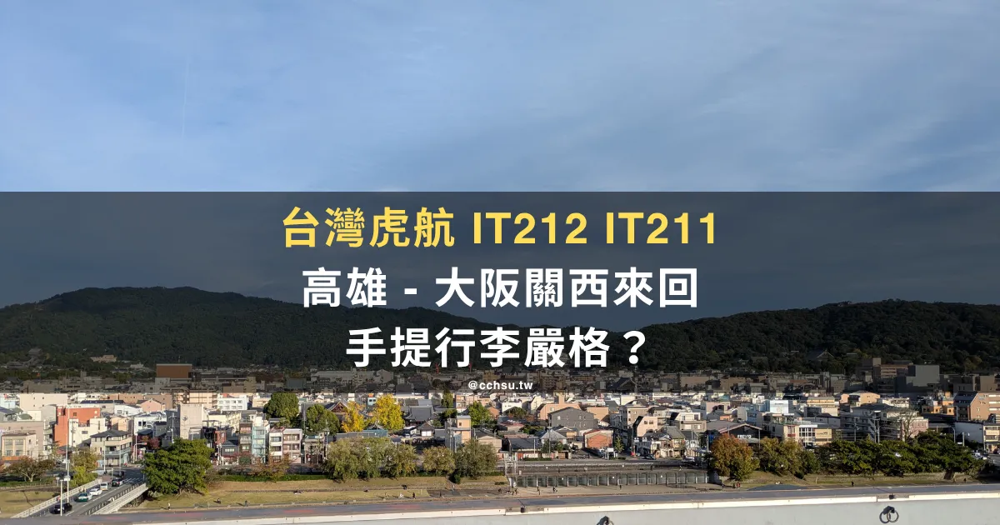
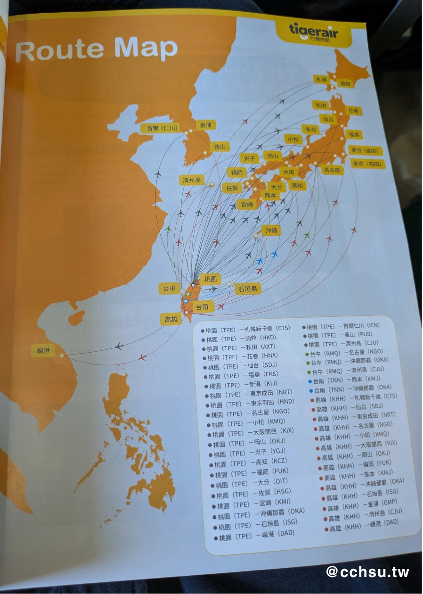
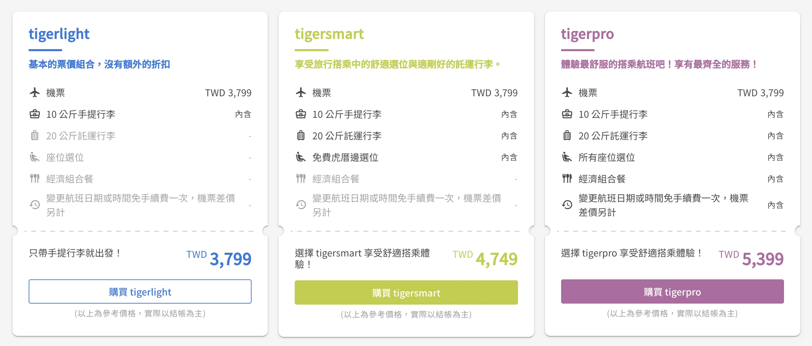
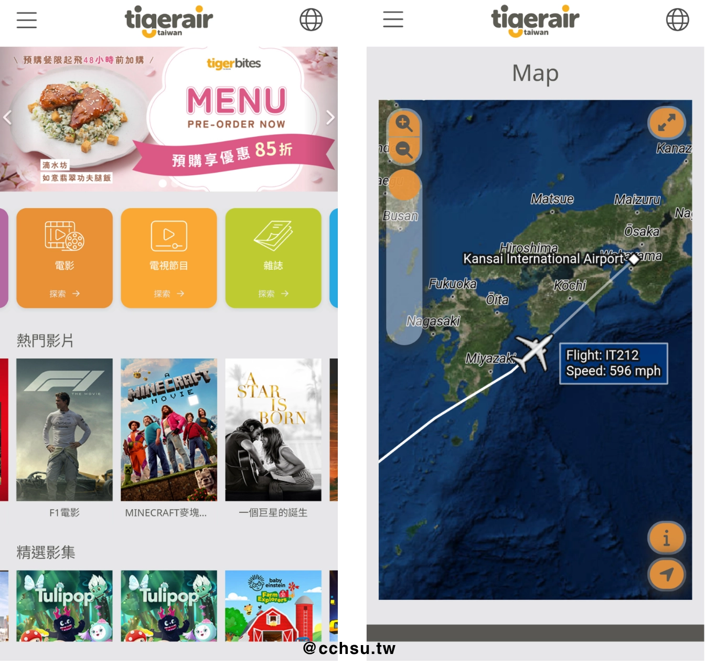

<figure class="post-figure">
  
</figure>

台灣虎航 (Tigerair Taiwan, IT) 被稱為是「半日空」，航點涵蓋日本大小城市。此文簡單分享 2026 年秋季搭乘 IT212 及 IT211 台北 TPE 來回大阪關西 KIX 的心得。此文簡單分享，如果不加購托運行李的話，只買最便宜的 tigerlight，整個流程是如何，請繼續看下去。

你可能也想看：<a href="https://cchsu.tw/posts/peach-khh-kix/" target="_blank">【2026 樂桃航空】MM32 高雄 - 大阪關西：經濟艙心得與手提行李限制</a>

  
快速瀏覽

- [台灣虎航 Tigerair Taiwan](#tigerair)
- [手提行李限制](#tpe)
- [台北 ↔ 大阪關西 IT212 與 IT211](#it212)
- [關西機場到市區](#kix)
- [台灣人去日本之人數探討](#taiwan)
- [結論](#conclusions)

## 台灣虎航 Tigerair Taiwan

台灣虎航（以下簡稱虎航）為華航旗下的低成本航空，目前共有 20 架全空中巴士 A320 機隊，每架配有 180 全經濟艙座位。在台灣除了桃園機場和高雄機場之外，還有台中與台南有零星幾條航線。

翻開機上雜誌（對，虎航還有紙本雜誌，而且不只一本），看虎航航點，除了越南的峴港 (DAD) 與韓國首爾仁川 (ICN)、金浦 (GMP)、釜山 (PUS)、濟州 (CJU) 之外，全都是日本航點（共飛行 22 個日本機場）。

<figure class="post-figure-small">
  
  <figcaption>台灣虎航機上雜誌的航點圖（2026年 11月）</figcaption>
</figure>

不過因為只有 20 架飛機，其中除了大航點（如東京成田、大阪關西、沖繩等等）之外，許多航點其實都不是每天飛。大部分小一點的航點，一週大概維持一至兩班的規模。

這種遍地開花的情況有點類似歐洲的 Ryanair 或者 Wizz Air（當然票價無法相提並論...）。主要是專攻點到點，而不是傳統的 Hub-and-Spoke 型態（先聚集到某大機場，再轉機）。

另外，因為這些航線大多飛時在兩小時至三小時之間，大多數的操作都是飛兩趟來回，加上單一機型的操作模式，都非常類似於 Ryanair 等低成本航空在歐洲線的操作（不過 Ryanair 有超過 600 架飛機，規模上無法相提並論）。

## 手提行李限制

在虎航官網購票的話，有分三種方案：tigerlight, tigersmart, tigerpro（如下圖）。

<figure class="post-figure">
  
  <figcaption>台灣虎航購票方案</figcaption>
</figure>

需注意這些票價都是未稅價格，含稅大概要再加一千台幣。其中比較特別的是手提行李的部分：一般來說，手提都是七公斤，不過虎航給到十公斤（兩件合計）。

最便宜的 tigerlight 就是只有手提行李；中間的方案 tigersmart 有 20 公斤托運，加上可以選虎厝邊的位置（通常是中後段的位置）；最貴的方案 tigerpro 則包含 tigersmart 所有的東西，但所有的位置都可選，還有東西吃。

❓ 你可能想知道：手提行李會量尺寸嗎？會秤重嗎？

我這次帶一個小登機箱（符合<a href="https://www.tigerairtw.com/zh-TW/welcome-on-board/baggage" target="_blank" rel="noopener noreferrer">官方規定（點我）</a>（2026年 11月）：手提行李限制為尺寸 54 x 38 x 23 公分），加上一個筆電包，沒有托運行李。

因為來回都直接線上 check-in，用手機登機證過安檢與護照查驗，不需到櫃檯排隊，節省許多時間。但來回兩次到登機門都被廣播，要求檢查隨身行李。不過都沒有被秤重，只有在關西機場時被要求放在測量手提行李大小的東西上（非鐵架，是可一次測量三邊長度的那種），大概看一眼就放行，供參。

## 台北 ↔ 大阪關西 IT212 與 IT211

#### IT212, TPE - KIX, A320

STD: 14:40 (UTC+8) / STA: 17:55 (UTC+9)

這班 IT212 似乎很少準時，看了近八天，有三天嚴重誤點到七點後才到，最晚甚至八點半才到，不過也有兩天準時。這趟飛機的運用大概都是早上六點多七點台北出發飛一個日本來回，再銜接這班 IT212。奇怪的是，有時候前面這兩段都準時，但到了這班就是會延遲。

這次被安排在 B3 登機門，最遙遠的那邊，但至少不是接駁車，還有空橋。但毫無意外也延遲，約 14:50 開始廣播登機。因為沒有付錢選位的關係，系統給我分配了惡意滿滿的 B 中間位，不過畢竟沒選位，也只能接受，還好航程約兩小時，並不算太久。

上機後發現虎航的椅距實在是慘絕人寰，相較於上次搭的樂桃：<a href="https://cchsu.tw/posts/peach-khh-kix/" target="_blank">【2026 樂桃航空】MM32 高雄 - 大阪關西：經濟艙心得與手提行李限制</a>，好像沒有窄成這樣。不過理論上應該都是 A320 機型，180 座位才對，可能樂桃的椅背比較薄？倒是虎航可能嚴控手提行李，頭頂置物櫃倒是有不少空間，不像是歐洲線，每次頭頂置物都爆滿。

登機完畢後，簡單目視了一下應該是滿座，沒有空位。起飛後不久就開始送餐，但點餐的人很少，可能不超過十個。機上餐食約在台幣 400 左右，可能大家都覺得兩小時，忍一下到日本再吃，或者在桃機先吃飽？更有可能下午三點並不是吃飯時間。送完餐之後開始販售免稅商品，機上有 Wi-Fi 可看現在飛到哪裡，不過如果要看電影之類的，就得額外付錢。

<figure class="post-figure-small">
  
  <figcaption>虎航機上娛樂系統截圖</figcaption>
</figure>

兩小時一下子就過了，移民官排隊人不少，現在有個機台自助掃 Visit Japan Web 的 QR code。掃描護照、拍照、按指紋，就會拿到 a b c d 的代號，到稅關就不用再操作一次機台，且到移民官那邊只要再拍照一次確定你是你就好。算是快上不少，大約排了十分鐘就取得貼紙，到行李提領區。

令人驚訝的是，走到稅關的地方有個類似電視的銀幕，播放像是監視器的即時影像。你經過的話，會在你的頭上顯示你是 a b c d 哪一個，令人毛骨悚然。走過去稅關那個門會自動辨識你的臉，辨識後門就會打開，代表完成所有程序，正式入境日本。

#### IT211, KIX - TPE, A320

STD: 11:30 (UTC+9) / STA: 13:50 (UTC+8)

回程其實就跟去程差不多，幾個小差異：這班過去八天全都準點，甚至好幾次都提早到。另外，回程比去程飛行時間多半小時左右（台北飛大阪約兩小時，大阪飛台北約兩小時半）。起飛前一天線上報到後，果然又喜獲中間位，只不過這次不是 B 而是 E。

虎航在關西機場使用的是跟大部分航空公司一樣的第一航廈，也是火車站的所在地，不用再搭接駁車。提早大概兩小時，約早上 9:40 抵達機場，這裡過安檢的好處是不用把筆電拿出來，約花了 10 分鐘過安檢，人很多，但算快，退稅的地方排了不少人，護照秒過之後就到了登機門區，此時約 10:15 左右。

關西機場今年整修後多了不少店，也寬敞許多。在機場閒晃發現，其實整個第一航廈都是互通的，並不一定要搭接駁車（類似文湖線的車）。只是如果跟著指標走，都會叫你去搭接駁車。比較神秘的是在 25 和 26 登機門之後，要走到 27 與 27+（號碼更大）的登機門需要先搭手扶梯向上，再搭電梯向下，就會到達另一邊，直接搭接駁車的確是比較快。

有趣的是這個在第一航廈內跑來跑去的接駁車其實有個名字 Wing Shuttle（日語：ウイングシャトル），外觀也是由設計機場的義大利建築師 Renzo Piano 所設計。有三節車廂，其中兩節是抵達專用，另一節是出發專用。

## 關西機場到市區

最後簡單講一下，關西機場到市區。如果用沒有 IC 卡（Suica 或各種卡），可在關西機場火車站購買 ICOCA，價格為 500 日幣，可選擇要儲值多少，最低應該是 2000 （500 + 儲值 1500）。但如果你是 Iphone 的話，建議直接用手機就好。

### 關空特急 HARUKA

因為要從關西機場去京都，除了可搭利木津巴士 2800 日幣之外，也可搭 HARUKA 火車，兩者時間差不多大概都一小時半左右。其中要搭火車的話，外國人必買特價車票只要 2200 日幣（不然原本自由席 3260 指定席 3590 日幣）。

建議直接 KKday 買車票，辦好<a href="https://www.westjr.co.jp/global/tc/ticket/westqr/" target="_blank" rel="noopener noreferrer">JR West QR 的帳號</a> ，這樣就可直接用手機刷 QR Code 進出站，不用再額外取票。

  <a href="https://www.kkday.com/zh-tw/product/18940-kansai-airport-haruka-ticket-japan?cid=24072" target="_blank" rel="noopener noreferrer" class="cta-button-kkday">
    <i class="ti ti-ticket"></i>
    
      透過 KKday 購買
      HARUKA 特急列車票
    
    <i class="ti ti-arrow-right cta-arrow"></i>
  </a>

更划算的是，這種票也可劃位搭指定席不用加錢。如果來不及劃位，也可直接去坐自由座，不過記得看好車廂（通常有三節自由座車廂在中段）。如果坐指定席的話列車長就不會再特別查票，直接睡到京都。但如果是自由座的話他會查票，因為很多人不太懂規則，刷交通 IC 卡就想搭，但這班車就類似自強 3000 不能持悠遊卡搭乘。

## 台灣人去日本之人數探討

結尾之前岔題一下，在社群媒體上常常看到，隨時都有一堆人去日本，那到底有多少台灣人去過日本？或者更精準一點，每年在台灣 2300 萬人中，會有多少人去日本至少一次？

我一直有個假說，因為社群網站的關係，常常放大一些其實很稀有的事情，所以其實沒有「看起來」那麼多。

1. 假說一：去日本其實是極少數人（<10%）的活動。
1. 假說二：去的人會一去再去，不去的人一輩子一次也不會去。

首先，先看資料顯示台灣持有（還沒過期的）護照的人大概是 60%（未查證，新聞寫的），約 1400 萬本護照，也就是說至少（有護照者不一定出過國）有 40% 的人（快 1000 萬人）不曾出過國。

另外再看一個數字，2025 年去日本的旅客中只有 12.1% 台灣旅客是第一次去日本，另外 87.9% 為第二次或以上，甚至有 8.8% 的人已造訪超過 20 次（<a href="https://travel.udn.com/travel/story/9650/9536512" target="_blank" rel="noopener noreferrer">資料來源：聯合報新聞網</a>）。所以「假說二」可算是成立，如果這個新聞可信的話，大部分去日本的人都是一去再去。

再看另一個數字，2025年台人赴日旅遊人次高達 673.1萬人次。但這邊寫的是「人次」，也就是說，一個人一年去個三次，就算三人次。為什麼突然有種在寫論文的感覺？總而言之，這邊唯一一個未知變數就是，到底平均一個人一年去幾次日本。在此就大概抓一下，介於 1.6 - 2.5 次好了，換算下來一年去日本「至少一次」的人為 270 萬到 420 萬左右。好吧，那還真的是蠻多的。

所以，關於「假說一」，去日本到底是不是少數人的活動？如果這個未知變數「平均一個人一年去幾次日本」真的如我假設介於 1.6 到 2.5 之間的話，那 2025年去日本至少一次的人，大概為總人口的 11.7% - 18.2% 左右，所以假說一（<10%）不成立。

## 結論

最後簡單結論，虎航椅距真的好窄，而且沒付錢選位得到中間位置成就達成 2/2。還好飛行時間不長，算是中規中矩的選項。回程還搶到旅展特價票單程約 4000 台幣（票價 9500、稅金 6630、預定及服務費 1900，共 18030 日幣）。只是去程的 IT212 慣性遲到，很容易要在機場白白等候。

  

    

      
🇯🇵 日本自助旅行專區

      
以下連結為合作推廣，點擊購買可支持本站

    

  

  

    
<i class="ti ti-wifi" aria-hidden="true"></i>

    

      
日本上網 eSIM

      

        <a href="https://www.kkday.com/zh-tw/product/243815-kddi-japan-esim-unlimited-data?cid=24072" target="_blank" rel="noopener noreferrer" class="aff-link">KKday KDDI 高速原生日本eSIM<i class="ti ti-external-link"></i></a>
        <a href="https://airalo.go.link/1BBox" target="_blank" rel="noopener noreferrer" class="aff-link">Airalo 推薦碼 <i class="ti ti-external-link"></i></a>
      

    

  

  

    
<i class="ti ti-train" aria-hidden="true"></i>

    

      
關西機場交通

      

        <a href="https://www.kkday.com/zh-tw/product/18940-kansai-airport-haruka-ticket-japan?cid=24072" target="_blank" rel="noopener noreferrer" class="aff-link">HARUKA 特急（往京都） <i class="ti ti-external-link"></i></a>
        <a href="https://www.kkday.com/zh-tw/product/19691-nankai-rapit-airport-express-kix-to-osaka?cid=24072" target="_blank" rel="noopener noreferrer" class="aff-link">南海電鐵 Rapi:t（往大阪難波）<i class="ti ti-external-link"></i></a>
      

    

  

  

    
<i class="ti ti-ticket" aria-hidden="true"></i>

    

      
大阪旅遊必備

      

        <a href="https://www.kkday.com/zh-tw/product/182272?cid=24072" target="_blank" rel="noopener noreferrer" class="aff-link">大阪環球影城門票<i class="ti ti-external-link"></i></a>
        <a href="https://www.kkday.com/zh-tw/product/19513-osaka-abeno-harukas-300-observatory-tickets-japan?cid=24072" target="_blank" rel="noopener noreferrer" class="aff-link">阿倍野展望台門票<i class="ti ti-external-link"></i></a>
      

    

  

